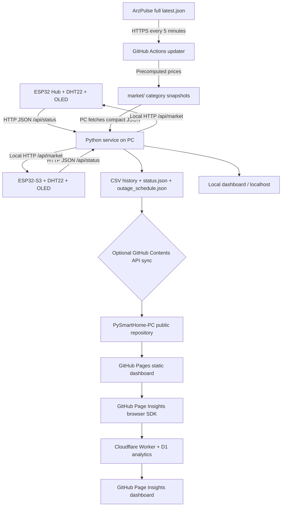

# 🏠 PySmartHome-PC

<p align="center">
  <strong>Local-first ESP32 telemetry · resilient OLED firmware · live Iran-market prices</strong><br>
  <sub>ESP32 / ESP32-S3 → Python collector → local dashboard → optional GitHub Pages sync</sub>
</p>

<p align="center">
  <a href="https://github.com/mehrdadmb2/PySmartHome-PC/actions/workflows/ci.yml"></a>
  <a href="LICENSE"></a>
  
  
  
  
  
  
  
  
  
  
  <a href="https://mehrdadmb2.github.io/PySmartHome-PC/"></a>
  <a href="https://github.com/mehrdadmb2/PySmartHome-PC/stargazers"></a>
</p>


> **Project summary (فارسی):** سامانه‌ای برای خواندن دما و رطوبت از بردهای ESP32، ذخیره‌سازی محلی CSV، نمایش زنده و تاریخچه در داشبورد، برنامه‌ریزی خاموشی برق، همگام‌سازی انتخابی با GitHub و انتشار یک داشبورد عمومی روی GitHub Pages. اجرای محلی بدون GitHub هم کار می‌کند.

---

## Contents

- [Overview](#overview)
- [Capabilities](#capabilities)
- [Architecture and data flow](#architecture-and-data-flow)
- [Hardware and wiring](#hardware-and-wiring)
- [OLED monitors and automated market snapshots](#oled-monitors-and-automated-market-snapshots)
- [Software requirements](#software-requirements)
- [Quick start on Windows](#quick-start-on-windows)
- [Persian setup guide](SETUP_FA.md)
- [Firmware setup](#firmware-setup)
- [Configuration reference](#configuration-reference)
- [Local, online, offline, and desktop modes](#local-online-offline-and-desktop-modes)
- [GitHub Pages and traffic analytics](#github-pages-and-traffic-analytics)
- [Data storage and CSV format](#data-storage-and-csv-format)
- [Local HTTP API](#local-http-api)
- [Security and privacy](#security-and-privacy)
- [Testing and development](#testing-and-development)
- [Troubleshooting](#troubleshooting)
- [Project structure](#project-structure)
- [Roadmap](#roadmap)
- [Contributing and license](#contributing-and-license)

## Overview

PySmartHome-PC is a self-hosted environmental monitoring project. Small ESP32 nodes read temperature and humidity, expose a small HTTP status endpoint, and use a Python service on a PC as the polling, storage, and publishing layer. A responsive dashboard displays current readings, historical trends, diagnostics, and a configurable power-outage schedule.

The project intentionally separates sensor firmware from the dashboard and server. The firmware stays small; the PC handles polling, CSV logging, charts, API validation, and optional publishing. The same web assets are served by the Python service and published as a static site, so visual and frontend fixes do not need to be maintained in two separate interfaces.

### Design goals

- **Local-first:** sensor collection and the local dashboard do not depend on GitHub availability.
- **Resilient:** bounded HTTP requests, last-known readings, failure counters, a background polling loop, atomic file replacement, input validation, and retry-on-next-cycle behavior.
- **Transparent:** measurements are stored as ordinary CSV files and can be inspected, downloaded, backed up, or analyzed outside the app.
- **Portable:** run from Python, open it as a local web application, install the browser shell as a PWA, or build an optional Windows desktop wrapper.
- **Static-site compatible:** the public dashboard reads committed files and does not need a GitHub token in browser code.
- **Extendable:** the JSON sensor endpoint is intentionally simple and the API/data formats are documented.

## Capabilities

### Sensor telemetry

- Supports an ESP32 hub (128×64 SSD1306) and an ESP32-S3 node (128×32 SSD1306) out of the box.
- Both OLEDs show live DHT22 temperature/humidity and the two ArzPulse market values: USD/USDT-derived dollar rate and one gram of 18-karat gold, displayed in Toman.
- Reads only a tiny local HTTP endpoint from the PC (`/api/market`). The PC retrieves the precomputed GitHub snapshot; neither board performs TLS, downloads the full ArzPulse feed, nor converts currencies.
- Uses a compact four-card layout on the 128×64 display; the 128×32 display scrolls a boxed market ticker so neither full price is permanently truncated.
- Retains the last validated market snapshot in memory and on disk across service restarts, uses primary/fallback GitHub origins with bounded retry backoff, and marks old/source-stale values with a `~` indicator.
- Reads JSON from each node's `GET /api/status` endpoint.
- Accepts the firmware's `temp` key and the clearer `temperature` alias, alongside `humidity`.
- Records timestamped measurements to per-node, per-day CSV files.
- Tracks online/offline status, last successful sample, response latency, sample count, consecutive failures, and temperature thresholds.
- Validates readings before storage (finite numeric values and sensible temperature/humidity ranges).
- Uses request timeouts; failed nodes do not stop polling the other node.

### Dashboard and analysis

- Live sensor cards, status indicators, latency, sample count, and last-seen labels.
- Historical charts for today, yesterday, seven days, and thirty days.
- Single-node and combined-node chart views, zoom/pan support, and CSV export.
- Min/max/average statistics, basic trend comparisons, and threshold alerts.
- Recent measurement table and an expanded table view.
- Persian-calendar date display and Iran-time clock (`Asia/Tehran`, UTC+03:30).
- Ten selectable themes: Midnight, Cyberpunk, Ocean, Aurora, Forest, Sunset, Candy, Retro CRT, Matrix, and Light.
- Responsive layout, subtle animated background, keyboard-accessible native controls, toast messages, and graceful chart-library fallback.

### Power-outage planner

- Rolling two-hour periods from 09:00 through 21:00.
- Friday is skipped and does not consume a cycle slot.
- Editable reference date/time through the local dashboard.
- Schedule generation around the selected reference and a live countdown to the next outage or power-return time.
- Schedule is persisted in `data/outage_schedule.json` and can be published to the static dashboard.

> The outage planner is a **user-configured schedule**, not a utility-provider feed. Validate the times against your local electricity provider before relying on them.

### Data file manager (local server only)

- Lists sensor CSV and published status/schedule JSON files.
- Downloads supported files.
- Imports validated sensor CSV files and prevents accidental overwrite unless explicitly enabled.
- Deletes sensor CSV files only; system JSON files cannot be removed through the delete action.
- Restricts filenames to supported patterns, enforces a 5 MiB upload limit, validates row values, and writes uploaded files atomically.
- The static GitHub Pages dashboard does not expose file management because a static site cannot write to the repository or the PC.

### Reliability, operations, and portability

- Configurable sensor URLs, ports, polling intervals, timeouts, thresholds, publishing branch, and GitHub identity.
- Optional `.env` file and ignored local `config.txt` token file.
- Health and diagnostics endpoints for status checks and troubleshooting.
- Avoids creating a new GitHub commit when the remote file contents have not changed.
- Local-only bind by default; remote write operations from another machine require an admin key.
- Optional installable PWA shell with a service worker that caches application assets and previously fetched public data. Live API responses are deliberately not cached as current truth.
- Optional embedded Windows desktop shell using pywebview, with a browser fallback.
- GitHub Actions CI checks Python compilation, JavaScript syntax, and automated tests.

## Architecture and data flow



The PC is the control and persistence point. ESP32 nodes do not upload sensor history directly to GitHub. If GitHub publishing is disabled or temporarily unavailable, local sensor collection continues. Market collection is deliberately outside the microcontrollers: GitHub Actions reads ArzPulse's full source JSON, validates the two required values, converts them to Toman, and publishes small categorized files. The PC fetches only `market/esp32.json` in a background Python thread and serves a validated copy at `http://<PC-LAN-IP>:5000/api/market`. Both boards use plain HTTP on the trusted local LAN; they do not run TLS, parse the large ArzPulse feed, or calculate prices. Each board fetches the compact response in a low-priority FreeRTOS task, separate from its sensor/display loop.

## Hardware and wiring

### Bill of materials

| Part | Qty. | Purpose / notes |
|---|---:|---|
| ESP32 DevKit-compatible board | 1 | Hub node, default IP `192.168.1.119` |
| ESP32-S3 development board | 1 | Second sensor node, default IP `192.168.1.115` |
| DHT22 (AM2302) sensor | 2 | Temperature and relative humidity |
| SSD1306 I²C OLED, 128×64 | 1 | Hub display |
| SSD1306 I²C OLED, 128×32 | 1 | ESP32-S3 display |
| USB cables / reliable USB power adapters | 2 | Programming and power |
| Windows PC / laptop | 1 | Python service, CSV storage, and dashboard |
| Wi-Fi access point / router | 1 | ESP32 and PC should be on a network that allows PC-to-node HTTP requests |
| Breadboard, jumper wires, suitable DHT22 pull-up if required | As needed | Assembly and sensor wiring |

### Default pin mapping

| Signal | ESP32 hub | ESP32-S3 node |
|---|---:|---:|
| DHT22 data | GPIO 13 | GPIO 6 |
| I²C SDA | GPIO 5 | GPIO 5 |
| I²C SCL | GPIO 4 | GPIO 4 |
| OLED I²C address | `0x3C` | `0x3C` |
| Display | 128×64 | 128×32 |
| Default static IP | `192.168.1.119` | `192.168.1.115` |

**Electrical note:** ESP32 GPIOs are 3.3 V logic. Check your exact board and sensor module wiring before powering it. Do not feed 5 V signals into an ESP32 GPIO. If your router uses a different subnet, change both firmware IP settings and the PC service URLs together, or change the firmware to DHCP and reserve addresses in the router.

## OLED monitors and automated market snapshots

The two sketches are adapted to their display dimensions:

| Board | OLED | Layout |
|---|---:|---|
| ESP32 Hub (`Board-Code/esp32_hub/esp32_hub.ino`) | 128×64 | Temperature and humidity cards, plus dollar and one-gram 18K gold prices |
| ESP32-S3 (`Board-Code/esp32_s3/esp32_s3.ino`) | 128×32 | Temperature and humidity cards, plus a scrolling ticker containing both prices |

### GitHub Actions market pipeline

The workflow `.github/workflows/update-market-snapshot.yml` runs every five minutes, can be started manually, and is also triggered after the ordered Project CI pipeline succeeds on `main`. Project CI runs Python/frontend checks first and compiles both ESP32 firmware targets second; only a successful CI completion triggers the post-change market refresh. It downloads the full source only on the GitHub-hosted runner, validates the source fields, converts IRR to Toman once, and writes these small outputs:

| Repository path | Purpose |
|---|---|
| `market/currencies/usd.json` | Categorized USD/USDT reference rate in Toman |
| `market/metals/gold_18k_1g.json` | 18-karat gold price per gram in Toman |
| `market/esp32.json` | Minimal combined payload used by both boards (two integer prices and stale flags) |
| `market/status.json` | Snapshot generation time, source age, and output size |

The PC service reads this small file from the exact GitHub Contents API file endpoint first:

`https://api.github.com/repos/mehrdadmb2/PySmartHome-PC/contents/market/esp32.json?ref=main`

If that origin is temporarily unavailable, the PC tries the exact Raw GitHub file, jsDelivr mirror, and then ArzPulse's exact `docs/data/latest.json` endpoint (API, raw, CDN, and Pages). The `/tree/main/market` URL is only a GitHub HTML directory page and is never used as a JSON endpoint. The existing checked-in `market/esp32.json` is loaded as the initial cache before any network request.

The ESP32 boards do **not** contact that URL. They read the PC's local endpoint instead:

`http://<PC-LAN-IP>:5000/api/market`

That file contains no charts, history, other coins, or calculation inputs. The Action performs the IRR-to-Toman conversion (`IRR / 10`) and stale-source validation before publishing. The ESP32 receives only two ready-to-display integer values. The updater validates all required values before writing, so a failed source request leaves the last known-good snapshots untouched.

**One-time GitHub setting:** open the repository's **Settings → Actions → General → Workflow permissions**, select **Read and write permissions**, and save. No personal access token or additional GitHub secret is required; the workflow uses the repository-provided `GITHUB_TOKEN`. Scheduled runs only operate on the default branch. After uploading the project, run the workflow manually once and confirm that `market/esp32.json` has been created before expecting the OLED ticker to show prices.

### PC proxy and firmware network isolation

The Python service refreshes the compact snapshot every 300 seconds by default, aligned with the GitHub Action schedule. It validates the version, price values, timestamp, and 512-byte limit before replacing the in-memory cache. On first launch it seeds the cache from the checked-in `market/esp32.json`; afterward, a failed fetch preserves the last good snapshot in memory and in `data/market_snapshot_cache.json`, including across PC restarts. The source order is GitHub Contents API for the exact file, Raw GitHub, jsDelivr, then ArzPulse API/raw/CDN/Pages as an emergency PC-side extractor. The PC uses bounded connect/read timeouts, source-by-source fallback and exponential retry backoff, and marks old snapshots stale. The local endpoint `/api/market` returns the validated cache; `/api/health` and `/api/diagnostics` report proxy readiness, chosen source, cache age, and the last proxy error.

The ESP32 makes a plain HTTP request to the PC over the trusted home LAN. That request runs in a low-priority FreeRTOS task pinned to the network core—not inside `loop()`. The task uses a fixed 384-byte ArduinoJson document, rejects unexpectedly large responses, applies short connection/read timeouts, and retries with backoff (30 seconds up to five minutes). It does not establish TLS, perform currency conversion, or parse the full ArzPulse JSON. The last good values remain in memory during temporary failures. The board compares the snapshot's `updated_at` marker before refreshing its freshness timer, so repeatedly receiving an unchanged old cache does not make stale prices look fresh.

**PC LAN setup is required for prices:** version 4.1.2 enables LAN binding automatically for the ESP32 hardware profile, including migration from an older `.env` that still says `PYSMART_HOME_HOST=127.0.0.1`. Run `tools/enable_lan_firewall.ps1` as Administrator to allow TCP/5000 only from `LocalSubnet` on the Windows Private profile. Change `192.168.1.100` in both sketches to the actual PC LAN IP. Do not expose or port-forward port 5000 to the public internet. Set `PYSMART_HOME_LAN_ACCESS=0` to restore loopback-only mode.

### OLED and board recovery behaviour

- A failed OLED initialization no longer traps the firmware in an infinite loop. I²C addresses `0x3C` and `0x3D` are tried, the bus is scanned in Serial Monitor, and OLED initialization is retried periodically.
- A failed Wi-Fi connection no longer forces repeated ESP32 reboots. The board keeps sampling the sensor and retries the network connection.
- DHT22 readings are sampled every 2.5 seconds. Invalid readings do not overwrite the last valid sample.
- `/api/status` returns HTTP 503 until a valid sensor sample exists or when that sample becomes older than 20 seconds. The Python collector can therefore distinguish a real reading from a missing/stale sensor.
- `/api/health` reports Wi-Fi, sensor, OLED and market-feed readiness, the last HTTP status/error, snapshot age/time, free heap, minimum free heap, and reset reason.

**Important:** the firmware placeholders `YOUR_WIFI_SSID` and `YOUR_WIFI_PASSWORD` must be replaced before uploading. The default static IP addresses remain `192.168.1.119` (hub) and `192.168.1.115` (S3), matching the Python service defaults shown below.

## Software requirements

### Required for the Python/local dashboard

- Windows 10/11 recommended; other Python-capable operating systems may work but are not the primary packaged target.
- Python 3.11 or newer.
- Wi-Fi access from the PC to the sensor node IP addresses.
- Internet access only for installing packages, loading the chart libraries from the CDN, and optional GitHub publishing. Once the shell and relevant data have been cached, portions of the dashboard can work offline.

Python dependencies are listed in `requirements.txt`:

- Flask — local HTTP server and JSON API.
- Requests — sensor polling and GitHub Contents API calls.

### Required for firmware builds

- Arduino IDE or Arduino CLI with Espressif ESP32 board support installed.
- DHT sensor library (Adafruit).
- Adafruit SSD1306.
- Adafruit GFX Library (dependency of SSD1306).
- ArduinoJson 6.21.5 (parses only the fixed-schema compact snapshot using a 384-byte static document).
- ESP32 core libraries: `WiFi`, `WebServer`, `HTTPClient`, `WiFiClient`, and `Wire` (included with the Espressif Arduino core).

The current firmware does not require NTPClient. Install the Adafruit and ArduinoJson packages through Arduino IDE → Library Manager, and install the ESP32 platform through Boards Manager.

### Optional for the desktop executable

`requirements-desktop.txt` adds:

- `pywebview` for an embedded desktop window.
- `pyinstaller` to build the Windows folder distribution.

## Quick start on Windows

1. Download and extract the repository ZIP, or clone it:

   ```powershell
   git clone https://github.com/mehrdadmb2/PySmartHome-PC.git
   cd PySmartHome-PC
   ```

2. Double-click `setup_windows.bat`. It creates `.venv` and installs the required Python packages. Alternatively, create a virtual environment and install manually:

   ```powershell
   py -3 -m venv .venv
   .\.venv\Scripts\Activate.ps1
   python -m pip install --upgrade pip
   pip install -r requirements.txt
   ```

3. Update the sensor IP addresses in `.env` (copy `.env.example` to `.env`) or set environment variables. Check that each node responds from the PC, for example by opening `http://192.168.1.119/api/status` in a browser on the same LAN.

4. Start the backend by double-clicking `start_server.bat`, or run `python server.py` inside the activated environment.

5. Open [http://127.0.0.1:5000](http://127.0.0.1:5000) on the PC. The same service is also bound to the LAN interface by default so ESP32 nodes can reach `/api/market`; restrict it with the supplied Private/LocalSubnet firewall rule. No GitHub token is required for local sensor polling and dashboard operation.

6. To enable GitHub sync, set `PYSMART_GITHUB_TOKEN` as a user/system environment variable, or copy `config.example.txt` to `config.txt` and put your own token after `token `. Keep `config.txt` private; it is ignored by `.gitignore` in fresh clones.

### Run on the local network

Version 4.1.2 binds to `0.0.0.0` by default for the ESP32 hardware profile. The supplied firewall script permits TCP port 5000 only from `LocalSubnet` while Windows is on the Private profile. Run it from an elevated PowerShell window:

```powershell
New-NetFirewallRule -DisplayName "PySmartHome-PC LAN" -Direction Inbound -Action Allow -Protocol TCP -LocalPort 5000 -Profile Private
```

Remove it later with `Remove-NetFirewallRule -DisplayName "PySmartHome-PC LAN"`. Do **not** port-forward port 5000 to the public internet.

If other LAN devices need to edit the outage schedule, upload/delete CSVs, configure `PYSMART_HOME_ADMIN_KEY` to a long random value and enter that value in the dashboard's **LAN admin key** field. Read-only dashboard/file listing requires no key. Local loopback writes continue to work without the admin key.

## Firmware setup

### 1. Configure Wi-Fi and network addresses

Open the required sketch in Arduino IDE:

- `Board-Code/esp32_hub/esp32_hub.ino` for the ESP32 hub.
- `Board-Code/esp32_s3/esp32_s3.ino` for the ESP32-S3 node.

In each sketch, replace:

```cpp
const char* WIFI_SSID = "YOUR_WIFI_SSID";
const char* WIFI_PASSWORD = "YOUR_WIFI_PASSWORD";
```

Use the same 2.4 GHz Wi-Fi network that the PC can reach. Do not commit your real credentials to a public repository.

The default network addresses are intentionally aligned with the Python service:

| Node | Firmware IP | PC configuration variable |
|---|---|---|
| ESP32 Hub | `192.168.1.119` | `PYSMART_ESP32_1_URL` |
| ESP32-S3 | `192.168.1.115` | `PYSMART_ESP32_S3_URL` |

The default gateway/DNS is `192.168.1.1` and the subnet mask is `255.255.255.0`. If the router uses another subnet, update the firmware IP/gateway/subnet **and** the corresponding PC sensor URLs. Reserve the two static addresses in the router or make sure they are outside its DHCP pool. The two boards must never share an IP address.

`USE_STATIC_IP` is enabled by default to preserve compatibility with the Python service. Do not switch it to DHCP unless you also reserve the resulting IP in the router and update the PC URL.

### 2. Install the Arduino libraries

In Arduino IDE → Library Manager, install:

1. **DHT sensor library** by Adafruit.
2. **Adafruit SSD1306**.
3. **Adafruit GFX Library**.
4. **ArduinoJson 6.21.5**.

Install the Espressif **esp32** platform through Boards Manager. `WiFi`, `WebServer`, `HTTPClient`, `WiFiClient` and `Wire` are supplied by that platform.

### 3. Check pins and upload

| Setting | ESP32 Hub | ESP32-S3 |
|---|---:|---:|
| DHT22 data | GPIO 13 | GPIO 6 |
| OLED SDA | GPIO 5 | GPIO 5 |
| OLED SCL | GPIO 4 | GPIO 4 |
| OLED address | `0x3C` (fallback `0x3D`) | `0x3C` (fallback `0x3D`) |
| OLED size | 128×64 | 128×32 |
| HTTP endpoint | `http://192.168.1.119/api/status` | `http://192.168.1.115/api/status` |

Select the correct ESP32 board and COM port, compile, and upload. Open Serial Monitor at **115200 baud**. The boot log reports the ESP32 reset reason and free heap, I²C devices, OLED readiness, Wi-Fi connection attempts, DHT22 samples, background snapshot-task startup, HTTP status, JSON parsing outcome, and the last successful prices.

### 4. Verify the nodes from the PC

After the boards connect and the first valid DHT22 reading is taken, open these URLs from a device on the same LAN:

- Hub: `http://192.168.1.119/api/status`
- ESP32-S3: `http://192.168.1.115/api/status`
- Health diagnostics: append `/api/health` to either address.

A successful `/api/status` response includes the fields expected by the Python collector:

```json
{
  "node": "esp32_hub",
  "temp": 26.4,
  "temperature": 26.4,
  "humidity": 42.0,
  "wifi": true,
  "ip": "192.168.1.119",
  "prices": {
    "dollar_toman": 288998,
    "gold18k_toman": 24958134,
    "dollar_stale": false,
    "gold_stale": false
  }
}
```

The values above are illustrative only. Actual values come from the latest ArzPulse snapshot. `/api/status` returns HTTP 503 while the DHT22 has not produced a valid sample or when its last valid sample is more than 20 seconds old. The Python service reads `temp` (or the compatible `temperature` alias) and `humidity`; the extra diagnostics and market fields do not change the CSV schema.

### Firmware resilience and diagnostics

- The firmware does not intentionally restart merely because Wi-Fi, the DHT22, the OLED, the PC market proxy, or ArzPulse is unavailable. The boot log prints `esp_reset_reason()` so a power/brownout reset or watchdog reset can be distinguished from an ordinary startup.
- Wi-Fi reconnection is attempted periodically. Sensor sampling and the local HTTP service continue while network recovery is in progress.
- Failed OLED initialization is retried, and Serial Monitor reports whether the OLED is found at `0x3C` or `0x3D`.
- GitHub Actions parses the large ArzPulse source and publishes small category files. The PC retrieves only `market/esp32.json`, validates it, caches the last good copy, and serves it at `/api/market` over the trusted LAN.
- The boards use `WiFiClient` and plain local HTTP only; they do not use TLS or make requests to GitHub. Failed requests use bounded exponential backoff; the most recent successful prices remain in RAM and become stale if the snapshot timestamp stops changing.

### Important hardware note

If the OLED remains physically blank even during boot, the screen itself cannot display firmware diagnostics. Check common GND, 3.3 V/VCC compatibility, SDA/SCL orientation, the GPIO mapping, the OLED address, and the display module. Serial Monitor is the source of truth for the I²C scan and OLED initialization result. A wrong DHT22 wire does not normally prevent the OLED from showing its status.

### Node response

The Python collector accepts the firmware's `temp` key and the clearer `temperature` alias, alongside `humidity`. The endpoint is designed for a trusted private LAN; it is not an internet-facing authenticated API.

## GitHub Actions setup for market prices

1. Push the project to the `main` branch.
2. Open **Settings → Actions → General → Workflow permissions** and enable **Read and write permissions**.
3. Open **Actions → Update compact market snapshot → Run workflow** and run it once.
4. Confirm that `market/esp32.json` and the categorized files appear in the repository.
5. The scheduled workflow then refreshes the data every five minutes. No PAT, API key, or Cloudflare Worker is required for this feature.
6. On the PC, copy `.env.example` to `.env` if needed. LAN binding is enabled by default; run `tools/enable_lan_firewall.ps1` as Administrator and restart the service.
7. Find the PC's LAN IPv4 address with `ipconfig`. Replace `192.168.1.100` in both firmware sketches with that address, then verify `http://<PC-LAN-IP>:5000/api/market` from a browser on the LAN returns the compact JSON. The ESP32s will use this local endpoint, not GitHub directly.

If a scheduled run fails, the last successful market JSON files are preserved. On the OLED, a `~` prefix indicates that the source marked a quote stale or that the board has not observed a newer snapshot for ten minutes.

### When the board becomes completely unresponsive

The price request no longer runs in the main loop, so a market timeout should not stop DHT sampling or OLED refresh. If the whole board still locks (including its local `/api/health` endpoint), treat it as a separate system-level fault: temporarily disconnect the OLED and DHT22, use a short known-good USB cable and a stable regulated 5 V supply, then test the board alone. Reconnect one peripheral at a time. Inspect the Serial Monitor reset reason and minimum heap. If the physical RESET button also has no effect, check the board's supply, USB cable/port, reset circuit, and any peripheral short; firmware cannot repair a hardware power or reset-line fault.

## Configuration reference

Environment variables override built-in defaults. A `.env` file in the project/executable folder is also supported and does not override variables already exported by the operating system.

| Variable | Default | Description |
|---|---|---|
| `PYSMART_HOME_LAN_ACCESS` | `1` | Enable LAN binding for ESP32 nodes; set `0` for loopback-only mode |
| `PYSMART_HOME_HOST` | `0.0.0.0` | Bind address when LAN access is enabled |
| `PYSMART_HOME_PORT` | `5000` | HTTP port |
| `PYSMART_ESP32_1_URL` | `http://192.168.1.119/api/status` | Hub sensor endpoint |
| `PYSMART_ESP32_S3_URL` | `http://192.168.1.115/api/status` | ESP32-S3 sensor endpoint |
| `PYSMART_HOME_POLL_SECONDS` | `10` | Poll interval, constrained to 3–3600 seconds |
| `PYSMART_HOME_PUBLISH_SECONDS` | `300` | GitHub publish interval, constrained to 30–86400 seconds |
| `PYSMART_HOME_NODE_TIMEOUT` | `45` | Seconds after a successful sample before a node is stale/offline |
| `PYSMART_HOME_HTTP_TIMEOUT` | `4` | HTTP request timeout for sensor calls |
| `PYSMART_MARKET_SOURCE_URL` | GitHub Contents API file URL | Compact market snapshot source fetched by the PC; raw/CDN/ArzPulse origins are fallbacks |
| `PYSMART_MARKET_REFRESH_SECONDS` | `300` | PC market-cache refresh interval (aligned with the five-minute Action) |
| `PYSMART_MARKET_HTTP_TIMEOUT` | `5` | PC market-fetch timeout |
| `PYSMART_TEMP_ALERT` | `35` | Temperature alert threshold in °C |
| `PYSMART_GITHUB_USER` | `mehrdadmb2` | GitHub owner |
| `PYSMART_GITHUB_REPO` | `PySmartHome-PC` | Repository to publish to |
| `PYSMART_GITHUB_BRANCH` | `main` | Target branch |
| `PYSMART_GITHUB_TOKEN` | unset | Fine-grained token with Contents: Read and write on this repository |
| `PYSMART_HOME_ADMIN_KEY` | unset | Key required for write operations from non-loopback clients |
| `PYSMART_LOG_LEVEL` | `INFO` | Python logging level (for example `DEBUG`, `INFO`, `WARNING`) |

Recommended: keep secrets in environment variables or `config.txt`, not in firmware, HTML, JavaScript, `.env.example`, or README files. A GitHub Pages browser must never receive the GitHub write token.

## Local, online, offline, and desktop modes

| Mode | How it works | Read-only telemetry | Outage editor / file manager |
|---|---|---|---|
| Local web dashboard | Flask at `http://127.0.0.1:5000` | Live local API + CSV history | Enabled for loopback requests |
| LAN dashboard | Same Flask service bound to `0.0.0.0` | Live local API + CSV history | Local client works; remote writes need admin key |
| GitHub Pages | Static `index.html`, `app.js`, CSS, and committed `data/` | Last published status and public CSV history | Disabled; static websites cannot write to the PC |
| Installed PWA shell | Install from a supported modern browser over HTTPS/localhost | Cached app shell and previously fetched public files; live API remains network-only | Works when connected to the local server |
| Windows desktop window | `desktop_app.py` + optional pywebview | Same as local dashboard | Same as local dashboard |
| Browser fallback | `desktop_app.py` opens the default browser if pywebview is unavailable | Same as local dashboard | Same as local dashboard |

Do not open `index.html` directly as a `file://` URL for normal operation: browser origin/security rules can block API calls, service workers, and CSV fetches. Run the local server or use the public Pages site instead.

### Build the Windows desktop distribution

```powershell
py -3 -m venv .venv
.\.venv\Scripts\Activate.ps1
pip install -r requirements-desktop.txt
.\build_desktop.bat
```

The result is a **one-folder** distribution in `dist/PySmartHome-PC/`. Keep all files in that directory together; do not move only the `.exe`. The build script copies the current `data/` folder and firmware sketches. Persistent runtime data and optional `config.txt`/`.env` belong beside the executable. The first launch may be blocked by Windows firewall prompts if the host is deliberately exposed to the LAN.

## GitHub Pages and traffic analytics

### Publish the static dashboard

The static dashboard is in the repository root and can be hosted with GitHub Pages.

1. Open the repository **Settings → Pages**.
2. Choose **Deploy from a branch**.
3. Select branch `main` and folder `/(root)`, then save.
4. Confirm the deployment succeeds in the Pages settings or Actions tab.
5. The public dashboard URL is `https://mehrdadmb2.github.io/PySmartHome-PC/`.

The Python server optionally publishes changed daily CSV files, `data/status.json`, and `data/outage_schedule.json` through the GitHub Contents API. Syncing requires a token with write permission to this repository. Without a configured token, the server still runs locally but the online snapshot does not receive fresh updates.

**All committed `data/*.csv`, `status.json`, and the outage schedule are public in a public repository.** Do not store personal, safety-critical, or other confidential data in these files. Anyone can download a public CSV directly without opening the dashboard.

### GitHub Page Insights integration

`analytics-loader.js` integrates the browser SDK documented by [github-page-insights](https://github.com/mehrdadmb2/github-page-insights). It only loads the SDK when both conditions are met:

- The hostname is `mehrdadmb2.github.io`.
- The path starts with `/PySmartHome-PC/`.

It does not run on localhost or on a private LAN dashboard. The configuration uses:

- Worker: `https://github-page-insights-worker.game-developer-mb.workers.dev`
- Platform ID: `pysmarthome-pc-github-pages`
- Platform name: `PySmartHome-PC GitHub Pages`
- Platform type: `web`
- Advanced click/scroll/page-leave telemetry: disabled

The browser SDK sends pageview events to the Worker; it does not use a GitHub token. Visit [GitHub Page Insights dashboard](https://mehrdadmb2.github.io/github-page-insights/) to inspect analytics, and verify that the platform ID appears after the first production visit. If the SDK or Worker is temporarily unavailable, the smart-home dashboard continues operating normally.

To change the analytics platform identity or Worker URL, edit `analytics-loader.js`. Keep the platform ID stable unless you intentionally want a separate analytics series. See the upstream project's README and live `/v1/schema` for the current event/API contract.

## Data storage and CSV format

All runtime files live in `data/` beside `server.py` or beside the packaged executable. Files are grouped by node and Iran-local date:

- `esp32_1_YYYY-MM-DD.csv`
- `esp32_s3_YYYY-MM-DD.csv`
- `status.json`
- `outage_schedule.json`

Sensor CSV columns:

```csv
time,temperature,humidity
12:00:00,26.40,42.00
12:00:10,26.45,41.90
```

The service appends a row after each successful poll. This means the data directory can grow indefinitely. Back it up regularly and remove old CSV files only when you are certain they are no longer needed. The file manager deliberately limits delete actions to matching sensor CSV files.

`status.json` is a lightweight published snapshot with a schema version, generation time, node online/readings metadata, server heartbeat/publish status, and the configured temperature threshold. It does not contain the write token.

`outage_schedule.json` maps ISO dates to an outage start/end time, for example:

```json
{
  "2026-10-20": { "start": "13:00", "end": "15:00" }
}
```

## Local HTTP API

The Flask service uses JSON for API responses and disables caching for `/api/*` endpoints.

| Method | Endpoint | Purpose |
|---|---|---|
| `GET` | `/` | Serve the dashboard |
| `GET` | `/api/health` | Lightweight health/status check |
| `GET` | `/api/diagnostics` | Runtime configuration summary, disk info, sync status, uptime, and polling details (no secrets) |
| `GET` | `/api/dashboard` | Live sensor state, server heartbeat, thresholds, and local-mode configuration |
| `GET` | `/api/data?board=esp32_1&range=daily&date=2026-10-20` | Historical readings for a validated board/range/date |
| `GET` | `/api/outage` | Current outage schedule and rules |
| `POST` | `/api/outage/update` | Recalculate schedule around a reference date/start/end; non-loopback clients need the admin key |
| `GET` | `/api/datetime` | Current Gregorian date/time in Iran timezone |
| `GET` | `/api/files` | List permitted CSV/status/schedule files |
| `GET` | `/api/download?name=esp32_1_2026-10-20.csv` | Download a supported data file |
| `POST` | `/api/upload` | Upload a validated sensor CSV; form field `file`, optional `overwrite=true` |
| `DELETE` | `/api/files/esp32_1_2026-10-20.csv` | Delete a sensor CSV only |
| `GET` | `/data/<filename>` | Read static data files used by the public dashboard |

### API examples

Health check:

```powershell
curl http://127.0.0.1:5000/api/health
```

Diagnostics:

```powershell
curl http://127.0.0.1:5000/api/diagnostics
```

Update the schedule from a non-loopback client when `PYSMART_HOME_ADMIN_KEY` has been configured:

```powershell
curl -X POST http://PC-IP:5000/api/outage/update `
  -H "Content-Type: application/json" `
  -H "X-Admin-Key: YOUR_LOCAL_ADMIN_KEY" `
  -d '{"date":"2026-10-20","start":"13:00","end":"15:00"}'
```

The server validates all board IDs, dates, allowed time slots, CSV values, filenames, and upload size. Never expose this development-oriented local service directly to the public internet.

## Security and privacy

- **Rotate any credential that was ever committed.** A deleted or replaced file in the latest commit does not remove secrets from Git history, forks, caches, or clones.
- The repository's `config.txt` is a local-only file and is excluded by `.gitignore`. Do not re-add it with `git add -f`.
- Both firmware sketches now contain placeholders for Wi-Fi credentials. Set your local SSID/password before flashing; never publish real values.
- Use a fine-grained GitHub token restricted to this repository with only **Contents: Read and write** permissions needed for publishing. Revoke unused tokens.
- The server binds to loopback by default. For LAN mode, limit access with the OS firewall, keep nodes on a trusted network, set an admin key for remote write actions, and avoid router port-forwarding.
- ESP32 node endpoints are unauthenticated by design. Keep them on a trusted LAN/VLAN and do not expose them directly to the internet.
- Public Pages includes the contents of the committed data folder. Treat all files placed there as public.
- The analytics loader activates only on the project GitHub Pages URL and leaves advanced telemetry disabled. If you redistribute or adapt this project, review your disclosure/consent obligations and the upstream analytics privacy documentation for your use case.
- Consider backups before deleting measurement files. CSV deletion is irreversible through this UI.

## Testing and development

Install the development requirements and run the checks:

```powershell
py -3 -m venv .venv
.\.venv\Scripts\Activate.ps1
pip install -r requirements-dev.txt
python -m pytest -q
python -m compileall -q server.py desktop_app.py tests
node --check app.js
node --check bg.js
node --check analytics-loader.js
node --check sw.js
```

The test suite covers sensor-payload validation, outage-cycle rules, API input validation, CSV upload/download/delete restrictions, overwrite protections, and remote write authorization. It does not require real ESP32 hardware or a live GitHub token.

For hardware/network debugging:

1. Open `http://NODE-IP/api/status` on the PC.
2. Open `http://127.0.0.1:5000/api/health` and `/api/diagnostics`.
3. Inspect the Python terminal for `POLL`, `SYNC`, `OUTAGE`, and `SEC` log categories.
4. Check that the local `data/` directory is writable and has adequate disk space.
5. If GitHub sync fails, verify token permissions, repository owner/name/branch, internet connectivity, and rate-limit/error details in the log.
6. If the public dashboard does not update, inspect the committed `data/status.json` and the latest per-node CSV on GitHub before debugging the frontend.

## Firmware diagnostics (updated)

Both board firmwares expose `GET /api/health`. In addition to the Wi-Fi, sensor and OLED flags, the response includes:

- `price_http`: last HTTP status (negative values indicate client setup errors; `0` means no request has completed yet).
- `price_error`: short reason for the last failed request or `OK`.
- `price_age_ms`: milliseconds since the last new market snapshot (`0` before the first successful fetch).
- `price_updated_at`: `updated_at` marker from the compact file.
- `free_heap` and `min_free_heap`: current and minimum free internal heap reported by the ESP32 runtime.
- `reset_reason`: reset cause reported by the ESP32 runtime.

The S3 ticker shows the last known prices when available. Before the first successful fetch, it shows a short connection/error status. The firmware keeps the last good price values on transient failures and only resets the freshness timer when the snapshot's `updated_at` changes.

## Troubleshooting

| Symptom | Likely cause | What to check |
|---|---|---|
| OLED is completely blank | OLED power, common GND, SDA/SCL wiring, wrong GPIOs/address, or failed display module | Open Serial Monitor at 115200; inspect the I²C scan and `[OLED]` initialization lines. The firmware probes only `0x3C` and `0x3D` (to avoid a long full-bus scan if an I²C line is stuck) and retries initialization. |
| OLED shows Wi-Fi retry/offline | Placeholder/incorrect SSID or password, 5 GHz-only network, wrong static subnet/gateway, or weak signal | Set the real 2.4 GHz Wi-Fi credentials; check `NODE_IP`, gateway and subnet in the sketch. The firmware retries without rebooting. |
| Board is connected but appears offline in PySmartHome-PC | The board IP does not match the PC URL, PC firewall/network isolation, or DHT22 has not produced a fresh reading | Open the exact `/api/status` URL from the PC. Match `192.168.1.119` / `192.168.1.115` to the two `PYSMART_ESP32_*_URL` settings. |
| Market price shows `--` | The Action has not run, the PC cache is empty, the PC proxy is not LAN-accessible, or the snapshot is invalid | Run the market Action. Confirm `market/esp32.json` exists, check PC `http://127.0.0.1:5000/api/health` (`market_proxy_ready`), then open `http://<PC-LAN-IP>:5000/api/market` from the LAN. |
| Market price shows `~` | ArzPulse marked the source stale, or the board has not observed a newer Action snapshot for more than ten minutes | Check `market/status.json` and the `stale` flags in the category files. If `updated_at` stops changing, check the Actions run history and repository Workflow permissions. |
| Market request fails | PC service is not reachable from the board, the PC cache is empty, or the snapshot is not current | Check `PYSMART_HOME_HOST=0.0.0.0`, Windows Private-profile firewall, the PC LAN IP in both sketches, PC `/api/health`, and Serial Monitor `price_error`. The board's main loop does not perform market networking. |
| Both nodes appear offline | Wrong IP/subnet, Wi-Fi credentials, disconnected node, or PC firewall | Open each node `/api/status` from the PC and inspect Serial Monitor |
| Node endpoint responds with 503 | DHT22 has not produced a valid reading yet | Wiring, power, pull-up, GPIO, and sensor readiness |
| The dashboard cannot use live data | Server is not running, wrong port, or opened as `file://` | Start the server and use `http://127.0.0.1:5000` |
| GitHub sync is disabled | No token configured | Add `PYSMART_GITHUB_TOKEN` or local `config.txt` and restart |
| GitHub sync returns 401/403 | Token missing Contents permission, expired, or SSO/org restriction | Create a narrowly scoped token and verify repository/branch access |
| Public data is stale but local is current | Publishing is disabled/failed or Pages data has not been committed | Check `publish_error`, server logs, repository `data/` files, and Actions/Pages status |
| Charts do not render | CDN blocked/offline or Chart.js failed to load | Reconnect or open dev tools; table and CSV export remain available |
| File upload returns 409 | A file with that date/name already exists | Enable “Replace file if it already exists” after verifying the target file |
| Remote upload/schedule edit returns 403 | Remote write protection is active | Set `PYSMART_HOME_ADMIN_KEY` on the server and enter the matching key in the dashboard |
| PWA does not install/cache | Unsupported browser, not HTTPS/localhost, or stale worker | Use modern Chrome/Edge, reload the site, and inspect Application → Service Workers |
| Windows desktop window fails | pywebview engine/dependency unavailable | Try `start_server.bat` or use `desktop_app.py` browser fallback |
| A port is already in use | Another process is bound to 5000 | Set `PYSMART_HOME_PORT` to an available port and restart |

## Project structure

```text
PySmartHome-PC/
├── .github/workflows/
│   ├── ci.yml                     # Python tests and syntax validation
│   ├── firmware-build.yml         # Arduino CLI compile checks for both boards
│   └── update-market-snapshot.yml # Five-minute compact market feed updater
├── Board-Code/
│   ├── esp32_hub/esp32_hub.ino    # ESP32 Hub: 128x64 OLED + DHT22
│   └── esp32_s3/esp32_s3.ino      # ESP32-S3: 128x32 OLED + DHT22
├── scripts/update_market_snapshot.py # ArzPulse normalization and category output
├── market/                        # Small generated market JSON snapshots
├── data/                          # CSV history + status/schedule JSON
├── tests/
│   ├── test_server.py             # Local API and application tests
│   └── test_market_snapshot.py    # Market conversion and validation tests
├── app.js                         # Dashboard behavior, charts, uploads, and themes
├── analytics-loader.js            # GitHub Pages-only Page Insights SDK loader
├── bg.js                          # Lightweight animated theme-aware background
├── desktop_app.py                 # Optional pywebview desktop shell
├── index.html                     # Shared local / GitHub Pages dashboard
├── style.css                      # Responsive glass UI and themes
├── sw.js                          # Offline shell and cached static data
├── manifest.webmanifest           # Installable PWA metadata
├── icon.svg                       # App / PWA icon
├── server.py                      # Flask server, polling, CSV storage, GitHub sync, APIs
├── requirements.txt               # Runtime Python dependencies
├── requirements-dev.txt           # Runtime + tests
├── requirements-desktop.txt       # Optional desktop packaging dependencies
├── setup_windows.bat              # Windows first-run setup
├── start_server.bat               # Start local service
├── start_desktop.bat              # Start optional embedded desktop shell
├── build_desktop.bat               # Build the optional Windows folder distribution
├── .env.example                   # Safe configuration template
├── config.example.txt             # Safe local-token template
├── .gitignore                     # Excludes credentials and build artifacts
├── SECURITY.md                    # Security notes and incident checklist
├── RELEASE_NOTES_AND_MIGRATION.md # Upgrade, credential rotation, and deployment steps
├── CONTRIBUTING.md                # Contribution/testing guide
├── CHANGELOG.md                   # Version history
├── LICENSE                        # MIT license
└── README.md                      # This document
```

## Roadmap

Ideas that fit the existing architecture without replacing its local-first design:

- Add optional MQTT ingestion alongside the current HTTP sensor protocol.
- Add more sensor profiles and node discovery with explicit allowlists.
- Add calibration offsets, configurable per-node thresholds, and rule-based notifications.
- Add retention policies and scheduled zipped backups with explicit opt-in.
- Add signed API requests and a formal authenticated user model if remote administration becomes a requirement.
- Add data quality indicators, gap detection, and resilient import of legacy CSV formats.
- Vendor chart libraries locally for fully offline chart rendering.
- Add cross-platform desktop installers after validating runtime dependencies per target OS.

## Contributing and license

Issues and pull requests are welcome. Please avoid committing credentials, live Wi-Fi settings, private sensor exports, or any sensitive content in the `data/` directory. Run the tests and JavaScript syntax checks before submitting changes; see [CONTRIBUTING.md](CONTRIBUTING.md).

Released under the [MIT License](LICENSE).
